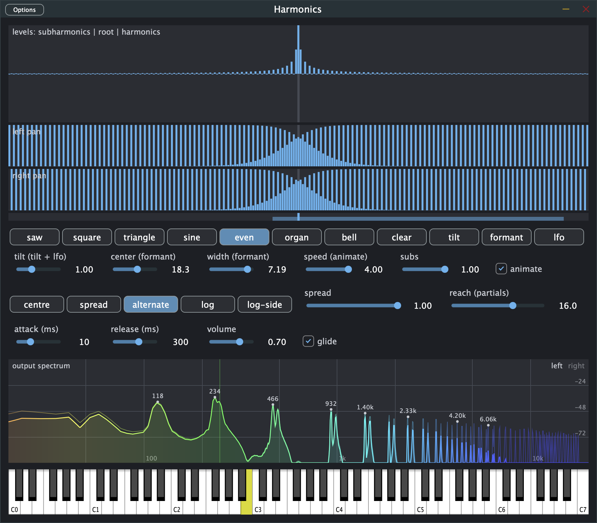

# harmonics-synth

An additive synthesizer plugin (AU, VST3 and standalone app) built with [JUCE](https://juce.com/). Each note is a sum of 129 sine waves: subharmonics below the root, the root, and harmonics above it. Their levels and stereo positions live in three tables that you can draw on, fill from a preset, or have an algorithm write and morph.



The synth started as a Pure Data patch, which is kept in [prototype/](prototype/) with its own [README](prototype/README.md). That README explains the sound design in detail (moving root, presets, algorithms, pan curves, glide); the plugin follows it.

## How a note is calculated

For a MIDI note with frequency *f*:

```
out(t) = envelope(t) × Σ amps[slot] × pan[slot] × sin(2π × f × ratio[slot] × t)
```

summed over the note's 129 slots, where `ratio` is 1/n for a subharmonic, 1 for the root and n for a harmonic. The tables hold 257 slots (128 subharmonics, the root, 128 harmonics) and each note uses a 129-slot window that slides with pitch, so the partials stay between 20 Hz and 18 kHz. Level changes are ramped over 30 ms so drawing on a table doesn't click.

## Building

You need CMake 3.22 or newer and a C++20 compiler (on macOS the Xcode command line tools are enough). JUCE 9.0.5 is downloaded by CMake the first time you configure.

```bash
cmake -S . -B build
```

```bash
cmake --build build -j 8
```

The results are in `build/Harmonics_artefacts/Release/`: `Standalone/Harmonics.app`, `AU/Harmonics.component` and `VST3/Harmonics.vst3`. To have them copied into `~/Library/Audio/Plug-Ins` after each build so that a DAW finds them, configure with `-DHARMONICS_COPY_PLUGINS=ON`.

## Using it

Play from a MIDI keyboard or click the on-screen one. Draw on the three graphs with the mouse; click a preset or pan curve to overwrite them. The algorithm sliders (tilt, center, width) only redraw the levels while tilt, formant or lfo is selected, and spread and reach only redraw the pans while a curve other than centre is selected. Moving subs always redraws the levels. The tables are saved with the plugin state.

The presets and algorithms fill the whole -1 to 1 range of the levels graph: the partials a preset uses alternate in sign (root positive), so saw is 1, −½, ⅓ … and triangle 1, −1/9, 1/25 …, the textbook series that make the true waveforms with every partial in sine phase. The levels' sizes are unchanged, so held notes sound the same; only the waveform shape changes (square, for instance, gets a peakier waveform with the same spectrum). The algorithms alternate every partial, so their signs don't flip while they morph.

The pan curves differ from the prototype in three ways, so that the sound doesn't lean to one side:

- **spread** sorts the partials by pitch in octaves (subharmonics towards the left, harmonics towards the right, most of the way out at harmonic *reach*). Instead of pivoting on the root it pivots on the point where the levels balance between the speakers, so the louder harmonics don't pull it right. The pivot follows the levels and is worked out for a note around middle C; low notes with subs turned up can still lean right a little, since they have few subharmonics to balance with.
- **log-side** still widens every harmonic towards one side, but balances itself the same way: the bass (subharmonics, root and 2×), which log keeps centred, moves towards the other side just far enough to even out the energy, and if even fully out isn't enough (say a formant peak high up) the harmonics narrow a little. It follows the levels too, so morphing with the mod wheel stays balanced.
- **log** picks each harmonic's side from the Thue–Morse sequence (the parity of the number of 1 bits in *n* − 1) instead of odd left / even right. Neighbours still mostly take turns, but the octaves of the root (4×, 8×, 16×) no longer all land on the right, which made presets like square and bell lean.

The graph above the keyboard is a spectrum analyser showing what actually comes out (left channel bright, right channel faint), from 20 Hz to 20 kHz and 0 dB (full scale) down to -96 dB. The loudest peaks are labelled with their frequency in Hz. The colour shows where a frequency lies relative to the last played note: green at its root, towards blue for harmonics and towards red for subharmonics, reaching full blue and red five octaves away.

The pitch and mod wheels sit to the left of the keyboard and follow a MIDI keyboard's wheels too. Drag a wheel up and down; the pitch wheel springs back to the middle when you let go, and double-clicking either wheel resets it. The pitch wheel bends every note by up to 2 semitones. The mod wheel (MIDI CC 1) morphs the formant and lfo algorithms: with the wheel at the bottom they are as drawn by their sliders, and pushing it up sweeps the formant peak up two octaves (center 8 reaches harmonic 32) and takes each lfo harmonic through one or more of its fade cycles. The amount slider scales that: 0 turns the wheel off, 0.5 gives one octave of formant sweep, 4 the most.

All other controls are automation parameters: Attack, Release, Volume, Subs, Tilt, Center, Width, Amount, Spread, Reach, Glide, Spectrum and Pan Curve.

## Files

- `CMakeLists.txt`: the JUCE plugin project
- `Source/SynthEngine.h/.cpp`: the synth itself (tables, presets, pan curves, voices), plain C++ with no JUCE dependency
- `Source/PluginProcessor.h/.cpp`: parameters, MIDI, state saving
- `Source/PluginEditor.h/.cpp`: the window (graphs, buttons, sliders, spectrum analyser, wheels, keyboard)
- `prototype/`: the original Pure Data patch
